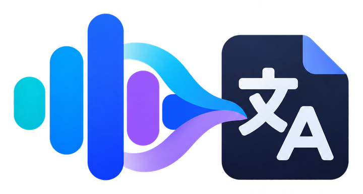
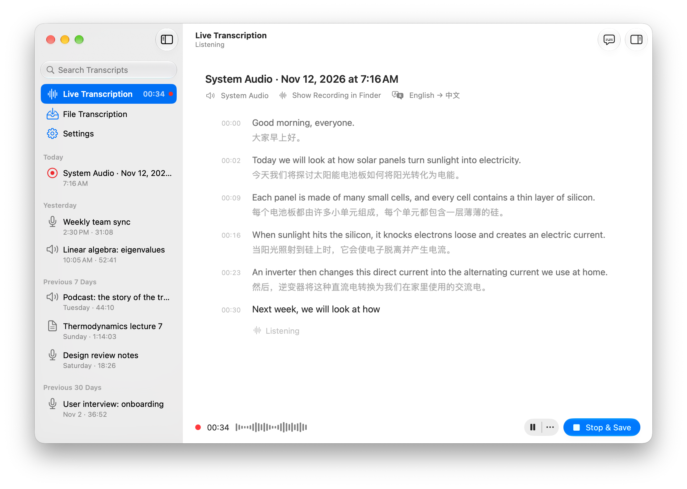
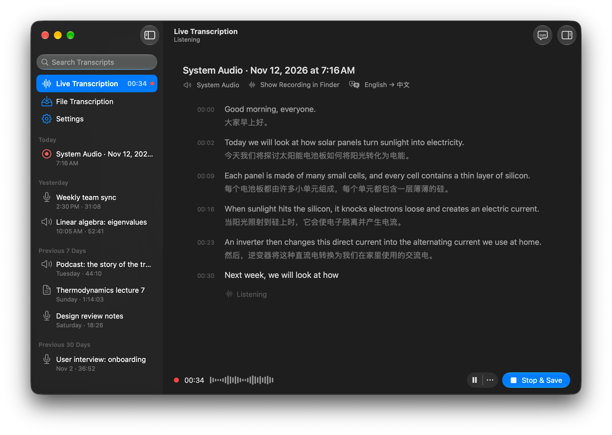
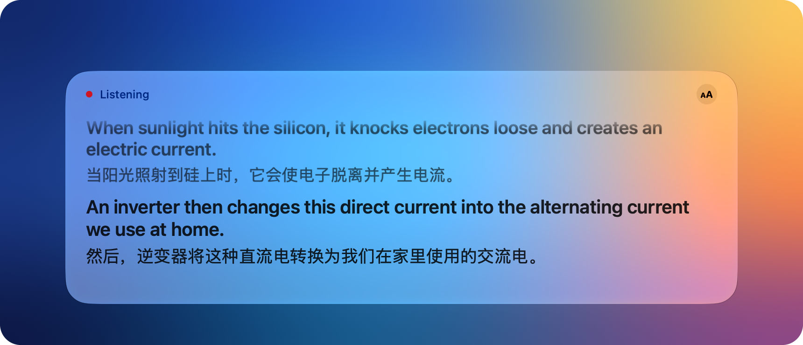
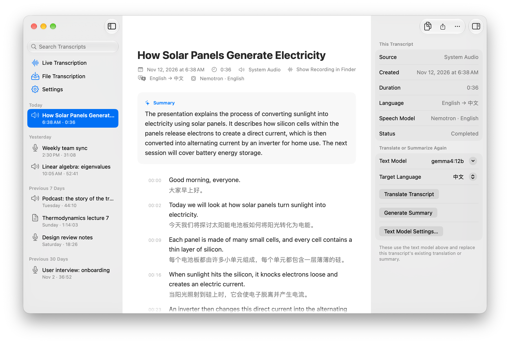

<p align="center"><picture><source media="(prefers-color-scheme: dark)" srcset="docs/images/logo-on-dark.png"></picture></p>

# Altranscribe

Real-time transcription and translation for Windows, Android and macOS. Microphone input, system audio and media files become transcripts, with floating bilingual captions.

[简体中文](README.zh-CN.md)


<details><summary>Dark theme</summary>


</details>

## Download

Get the app from [Releases](https://github.com/kiliasu/Altranscribe/releases):

- **Windows x64**: extract the zip and run `Altranscribe.exe`; keep the folder intact. The app is not code-signed, so Windows may say "Windows protected your PC" on first run; choose "More info → Run anyway". If Windows reports missing DLLs, install the [Visual C++ x64 runtime](https://aka.ms/vs/17/release/vc_redist.x64.exe). Transcribing audio and video files also needs [FFmpeg](https://ffmpeg.org/download.html) on your PATH.
- **Android 10 or later (ARM64)**: install the APK and allow installs from that source when asked. It asks for the microphone, the camera, notifications and drawing over other apps only when a feature needs them.
- **macOS 26 or later (Apple silicon)**: open the DMG and drag Altranscribe into Applications. The app is not notarized by Apple: after macOS refuses to open it the first time, choose **Open Anyway** under System Settings → Privacy & Security.

## Getting started

1. Under **Settings → Speech models**, choose how speech is recognized: a local model, a Windows host on your network, or OpenAI / Gemini. Local models are downloaded in the same panel, and on Windows so are the programs that run them.
2. For translations, titles and summaries, choose a text model under **Settings → Translation & LLM**: a local or online OpenAI-compatible service such as Ollama, or OpenAI, Gemini or Anthropic.
3. Pick the microphone, system audio or both, set the languages and start. For recordings, switch to **Files** and add one or more audio or video files.
4. **Stop & save** moves the transcript to the **Library**; the last sentences, translations and the summary finish in the background.

A phone can use your computer's models: turn on sharing on the computer's **Devices** page and scan its QR code with the phone; see [connecting to a Windows host](docs/en/remote-processing.md). The [model guide](docs/en/models.md) lists what each model needs, and [cloud services](docs/en/cloud-providers.md) covers their setup.

## Features

| Processing | Windows x64 | Android 10+ ARM64 | macOS 26+ (Apple silicon) |
| --- | --- | --- | --- |
| Local Whisper | CPU / NVIDIA GPU | No | Yes |
| Local Nemotron streaming models (CPU) | Yes | Yes | Yes |
| Local Nemotron 3.5 Transcribe | A 32 GB GPU such as the RTX 5090 | No | No |
| Local Parakeet, Apple SpeechTranscriber | No | No | Yes |
| Local Ollama or another OpenAI-compatible text service | Yes | Through a Windows host | Yes |
| Apple Intelligence text model on the device | No | No | Yes |
| Local network sharing | Host or client | Client | No |
| OpenAI / Gemini (speech and text), Anthropic and online OpenAI-compatible services (text) | Yes | Yes | Yes |

- Transcribe the microphone and system audio separately or together, with live translation.
- Floating captions show the original, the translation or both, with adjustable font, size, opacity and number of sentences.
- Queue WAV, MP3, M4A, FLAC, OGG, Opus, AAC, WMA, MP4, MKV, WebM and MOV files for transcripts, translations, titles and summaries.
- Search, copy, rename and delete transcripts; export them as TXT, Markdown, SRT subtitles or an HTML page, and jump to the source file. An HTML page with the file's audio or video highlights the sentence being played and follows playback.
- Names are translated the same way throughout. Add your own translation requirements, such as tone or preferred names, under Settings → Translation & LLM.
- File processing can correct names, terms and misheard words and join sentences that recognition split. The originals and each change stay viewable.
- English and Simplified Chinese interface, light and dark themes, amber or baseline colors.


Recognition and translation can contain errors, timestamps marked "≈" are estimates, and whether a file opens depends on its actual encoding. Speaker labels, WebVTT export and playback inside the app are not available.

## macOS

The Mac app is a separate native app with the same core: live transcription with translation, a file queue, floating captions and a searchable library.



<details><summary>Dark appearance</summary>



</details>

It differs from the Windows app in a few ways:

- Speech recognition offers Nemotron streaming models (the default), Whisper, Parakeet (English and 25 European languages), Apple SpeechTranscriber, or OpenAI / Gemini. Models download in Settings.
- Translation and summaries can also use Apple Intelligence on the device.
- It captures one source at a time: the microphone or the system audio.
- Files can be WAV, M4A, MP3, AAC, AIFF, MP4 or MOV, and whole folders can be dropped in.
- It has no local network sharing, automatic term correction or HTML player.





The [macOS guide](apple/README.md) (in Chinese) covers every engine, the data folders and permissions.

## Privacy

- **Audio**: on Windows and Android, live audio is processed in memory and never saved as a recording. The Mac app keeps a recording of each live session in `~/Documents/Altranscribe/Recordings/` unless **Save Recording** is off.
- **Transcripts**: they stay on the device that started the task, in `%LOCALAPPDATA%\Altranscribe\` on Windows, the app's private storage on Android and `~/Library/Application Support/Altranscribe/` on the Mac. Deleting a transcript keeps the imported files.
- **Uploads**: fully local processing uploads nothing. With a cloud service, audio and the related text go to that provider, which may charge for usage; work handed to a host goes to that host.
- **Credentials**: API keys and host credentials are encrypted by the operating system, so enter them again on a new device.
- **Network sharing**: it uses unencrypted HTTP; use it only on networks you trust. Cloud services always use HTTPS.
- **Logs**: they hold no transcripts or keys; **Settings → Logs** opens or shares them.

## Build from source

**Windows**: requires Flutter 3.47.3 and Visual Studio 2022 (or its Build Tools) with "Desktop development with C++".

```powershell
./dev.ps1
./dev.ps1 -Build -Release
```

The first command starts the app; the second builds the release version into `build/windows/x64/runner/Release/`. Android builds, tests and the project layout are in [Contributing](docs/CONTRIBUTING.md).

**macOS**: requires a Mac with Apple silicon, macOS 26, Xcode 27 or later and CMake (`brew install cmake`). From the repository root:

```sh
bash apple/scripts/bootstrap-whisper.sh
bash apple/scripts/build-app.sh
open build/macos/Altranscribe.app
```

Drag the built `Altranscribe.app` into Applications. Capturing system audio needs the **Screen & System Audio Recording** permission; the [macOS guide](apple/README.md) (in Chinese) has the rest.

## License

Application code: [MIT](LICENSE). Third-party components keep their own licenses, listed in the [third-party notices](docs/en/third-party.md); the Android app includes FFmpeg under LGPL 2.1+.
