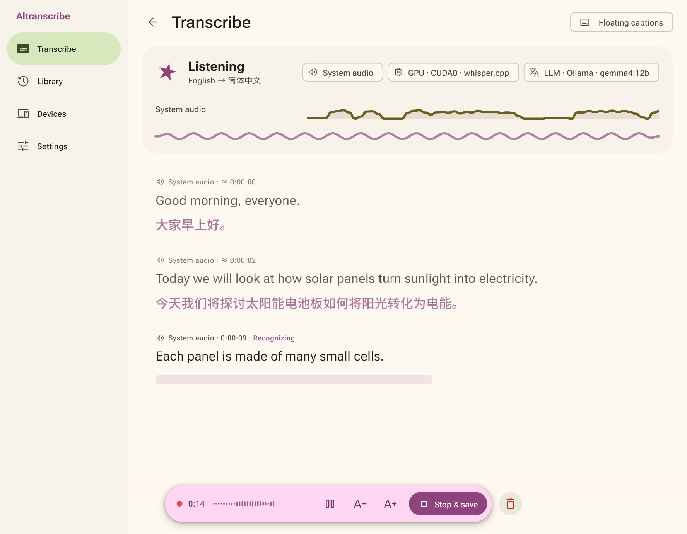
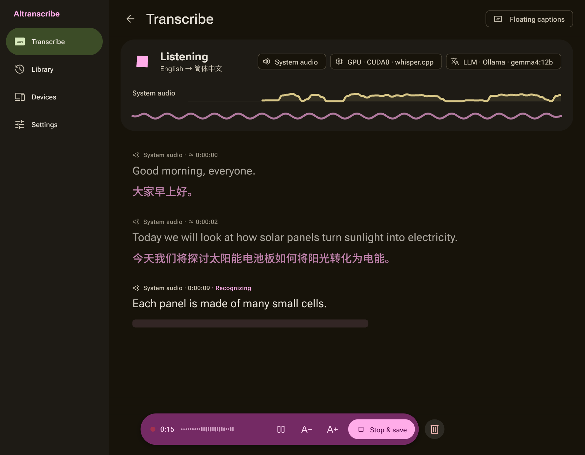
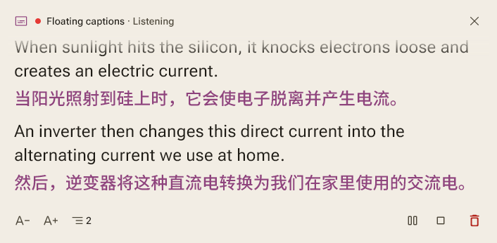
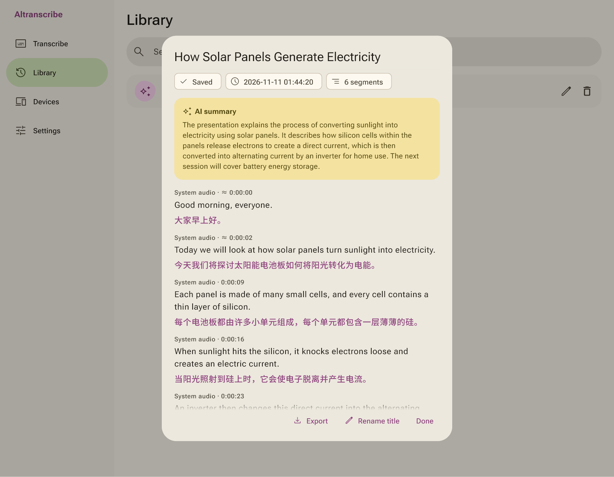

<p align="center"><picture><source media="(prefers-color-scheme: dark)" srcset="docs/images/logo-on-dark.png"></picture></p>

# Altranscribe

Real-time transcription and translation for Windows, Android and macOS. Microphone input, system audio and media files become transcripts, with floating bilingual captions.

Windows and Android share one Flutter app. The Mac has its own native app, written in SwiftUI for macOS 26 and Apple silicon; it lives in [`apple/`](apple/README.md) and is described under [macOS](#macos).

[简体中文](README.zh-CN.md)



<details><summary>Dark theme</summary>



</details>

## Download

1. Download the Windows zip or the Android APK from [Releases](https://github.com/kiliasu/Altranscribe/releases).
2. **Windows x64**: extract the zip and run `Altranscribe.exe`. Keep the folder intact: the app needs the DLLs and `data/` beside it. If Windows reports missing DLLs, install the [Visual C++ x64 runtime](https://aka.ms/vs/17/release/vc_redist.x64.exe). File transcription also needs [FFmpeg](https://ffmpeg.org/download.html) on your PATH.
3. **Android 10 or later (ARM64)**: install the APK and allow installs from that source when asked. Audio decoding is built in. The app asks for the microphone, the camera (to scan a host's pairing code), notifications (its background service shows one while transcribing) and permission to draw over other apps (floating captions) the first time each feature is used; system audio capture is confirmed every time. Audio and video files can also be sent to the app from the share menu.
4. **macOS 26 or later (Apple silicon)**: there is no signed download yet. Build the app as described under [macOS](#macos) and drag `Altranscribe.app` into Applications.

The Windows app is not code-signed, so Windows may say "Windows protected your PC" on first run; choose "More info → Run anyway".

## Getting started

1. Under **Settings → Speech models**, choose how speech is recognized: local Whisper on this computer, local Nemotron streaming models on the CPU (also on the phone), local Nemotron 3.5 Transcribe on a 32 GB Blackwell GPU such as the RTX 5090, a Windows host on your network, or OpenAI / Gemini.
2. For translations, titles and summaries, choose a text model under **Settings → Translation & LLM**, or turn them off on the home screen. **Prepare LLM** on the home screen loads the model before you start, so the first translations do not lag.
3. Pick the microphone, system audio or both, set the languages and start. For recordings, open **Files** and add one or more audio or video files; they are processed in order.
4. **Stop & save** moves the transcript to the **Library**. The last sentences, translations and the summary finish in the background; wait for them before starting the next task.

Pausing stops new capture while earlier speech finishes processing, and **Discard recording** deletes the current transcript. Closing the caption window only hides it.

**Keyboard (Windows):** `Ctrl+1` to `Ctrl+4` switch between Transcribe, Library, Devices and Settings, `Ctrl+F` searches the library and `Ctrl+O` adds files. `Ctrl+Shift+R` starts, `Ctrl+Shift+P` pauses or resumes, `Ctrl+Shift+S` stops and saves, and `Ctrl+Shift+C` shows or hides the floating captions. `Ctrl` with `+`, `-` or `0` changes the transcript's text size.

**Local models on Windows:** the model settings download and verify both the models and the programs that run them. Whisper has six models, Tiny to Large v3 Turbo, and runs in [whisper.cpp](https://github.com/ggml-org/whisper.cpp), built for NVIDIA GPUs or for the CPU; Nemotron 3.5 Transcribe runs in NVIDIA's [NeMo-Speech.cpp](https://github.com/NVIDIA/NeMo-Speech.cpp), see [its section](docs/en/models.md#nemotron-35-transcribe). The [model guide](docs/en/models.md) explains adding model files or a program of your own. For translation and summaries, run Ollama or another OpenAI-compatible text service on the same computer, enter an online OpenAI-compatible service with its API key, or use OpenAI, Gemini or Anthropic directly.

Other setups: [cloud services](docs/en/cloud-providers.md) and [connecting to a Windows host](docs/en/remote-processing.md), which lets a phone use your computer's models: turn on sharing on the computer, scan its QR code with the phone, and the host appears on the phone's **Devices** page. The phone can also transcribe with Nemotron itself and leave only translation and summaries to the computer.

## Features

| Processing | Windows x64 | Android 10+ ARM64 | macOS 26+ (Apple silicon) |
| --- | --- | --- | --- |
| Local Whisper | CPU / NVIDIA GPU | No | Metal |
| Local Nemotron streaming (CPU, sherpa-onnx) | Yes | Yes | Yes |
| Local Nemotron 3.5 Transcribe (32 GB Blackwell GPU, NeMo-Speech.cpp) | Yes | No | No |
| Local Parakeet (FluidAudio, Core ML) and Apple SpeechTranscriber | No | No | Yes |
| Local Ollama / OpenAI-compatible text model | Yes | Through a Windows host | Yes |
| Apple Intelligence text model on the device | No | No | Yes |
| Local network sharing | Host or client | Client | No |
| OpenAI / Gemini (speech and text), Anthropic and online OpenAI-compatible services (text) | Yes | Yes | Yes |

- Transcribe the microphone and system audio separately or together, with live translation.
- Floating captions show the original, the translation or both, with adjustable font, size, opacity and number of recent sentences. Pause, resume or stop and save from the caption window.
- Queue WAV, MP3, M4A, FLAC, OGG, Opus, AAC, WMA, MP4, MKV, WebM and MOV files for transcripts, translations, titles and summaries. Whether a file opens depends on its actual encoding.
- Search, copy, rename and delete transcripts; export them as TXT, Markdown, SRT subtitles or an HTML page and jump to the source file. An HTML page with the file's audio or video highlights the sentence being played and can follow playback.
- Names stay consistent: live translation reuses how earlier lines translated a name, and translated files get one fixed translation per name. Add your own translation requirements, such as tone or preferred names, in Settings → Translation & LLM.
- File processing can also correct names, terms and misheard words, and join sentences that recognition split (a separate option). The originals and each change stay viewable.
- English and Simplified Chinese interface, light and dark themes, amber or baseline colors.





Recognition and translation can contain errors, and timestamps marked "≈" are estimates. Speaker labels, WebVTT export and playback inside the app are not available. The app opens the way it was left: the interface language (the system's on a first run), theme, text size, languages, audio sources and options are remembered, like the caption settings, and on Windows the window returns to where it was and at its size.

## macOS

The Mac app is a separate native app, version 1.0.0, built with SwiftUI and AppKit around the same ideas: live transcription with translation, a file queue, floating captions and a searchable library. It follows macOS 26's design, with Liquid Glass bars and captions, a sidebar that lists every transcript by date, and Settings in its own window.

- **Speech**: Nemotron streaming in English or 3.5 multilingual (sherpa-onnx on the CPU, the default), Whisper Tiny to Large v3 on Metal, Parakeet v2, v3 and Ultra through FluidAudio on Core ML (English, or 25 European languages), Apple SpeechTranscriber, or OpenAI / Gemini for files, live speech and direct speech translation. Models download in Settings, Nemotron and Whisper checked by SHA-256; the app itself carries none.
- **Text**: Apple Intelligence on the device, Ollama and other OpenAI-compatible services, OpenAI, Gemini or Anthropic, for translation and summaries.
- **Capture**: a chosen microphone or the system audio (one at a time), with adaptive gain for quiet or distant voices. Each live session keeps an M4A recording unless **Save Recording** is off.
- **Files**: drop audio, video or whole folders; macOS decodes WAV, M4A, MP3, AAC, AIFF, MP4 and MOV, and a quiet-file boost helps distant recordings.
- **Library**: searched words are marked in the transcript; transcripts export as TXT, Markdown, HTML or SRT and move to the Trash with their recording when deleted.

It has no local network sharing, host pairing, FFmpeg, automatic term correction or HTML player, and records one source at a time. The [macOS guide](apple/README.md) (in Chinese) covers every engine, the data and model folders, permissions and the checks that were run.

## Privacy

On Windows and Android, live audio is processed in memory and never saved as a recording; the macOS app keeps an M4A recording of each live session in `~/Documents/Altranscribe/Recordings/` unless **Save Recording** is turned off. Transcripts stay on the device that started the task: `%LOCALAPPDATA%\Altranscribe\` on Windows, the app's private storage on Android, `~/Library/Application Support/Altranscribe/` on the Mac. Deleting a transcript keeps the imported files. A diagnostic log with no transcripts or keys goes to `Documents\Altranscribe\logs` on Windows and to the app's shareable folder on Android; **Settings → Logs** opens or shares it.

With a cloud service, audio and the related text go to that provider; work handed to a host goes to that host. Fully local processing uploads nothing. API keys and host credentials are encrypted by the operating system (the Keychain on the Mac), so enter them again on a new computer or phone. Network sharing uses unencrypted HTTP, which is why the Android app allows cleartext traffic; use it only on networks you trust. Cloud services always use HTTPS and may charge for usage.

## Build from source

Requires Windows, Flutter 3.47.3 and Visual Studio 2022 (or its Build Tools) with "Desktop development with C++".

```powershell
./dev.ps1 -Verify
./dev.ps1
```

The first command runs the analyzer and every test, the second starts the app. `./dev.ps1 -Build -Release` builds the release version into `build/windows/x64/runner/Release/`. Android builds, the project layout and distribution notes are in [Contributing](docs/CONTRIBUTING.md).

The macOS app needs a Mac with Apple silicon, macOS 26, Xcode 27 or later and CMake (`brew install cmake`). From the repository root:

```sh
bash apple/scripts/bootstrap-whisper.sh
bash apple/scripts/build-app.sh
open build/macos/Altranscribe.app
```

The first script builds a pinned whisper.cpp with Metal; the second builds the Swift package and assembles an ad-hoc signed app. macOS asks for the microphone, and for **Screen & System Audio Recording** to capture system audio. After a rebuild changes the signature, remove the old Altranscribe entry in **Privacy & Security** and add the new app. `swift test --package-path apple` runs its tests.

## License

Application code: [MIT](LICENSE). Third-party components keep their own licenses, listed in the [third-party notices](docs/en/third-party.md); the Android app includes FFmpeg under LGPL 2.1+.
