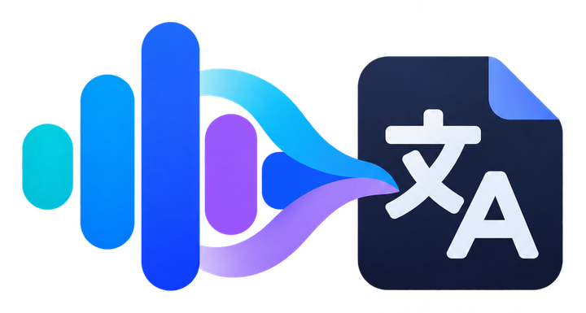
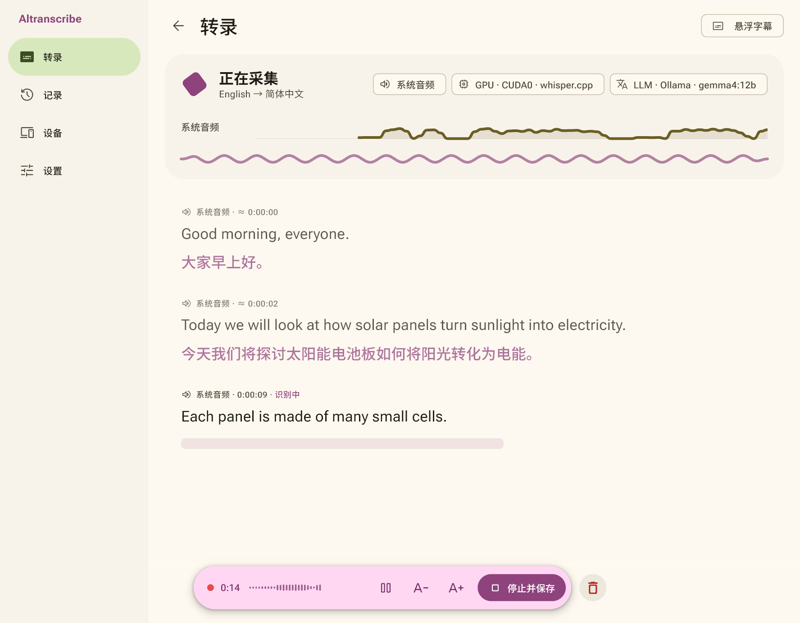
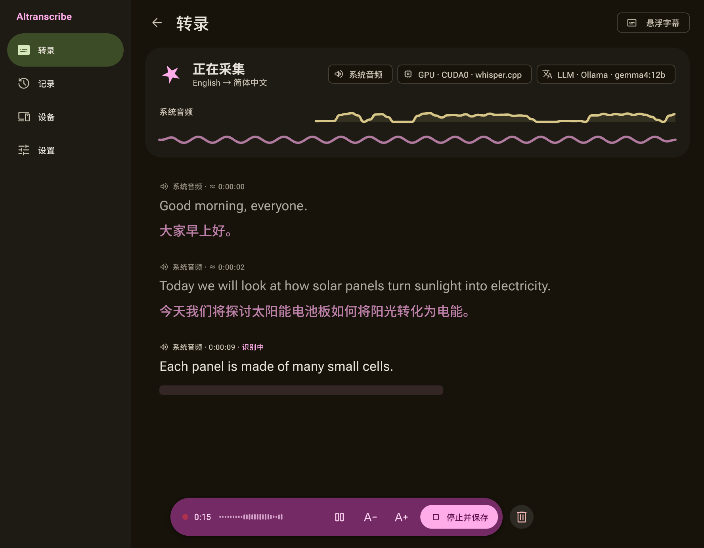
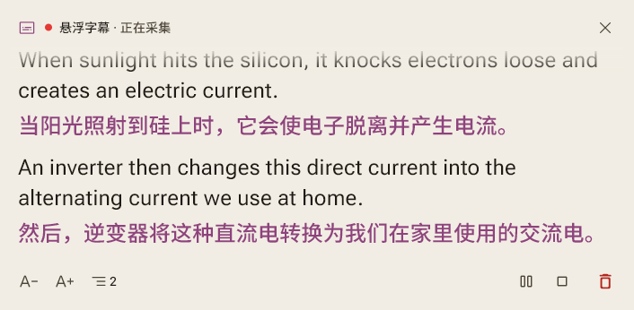
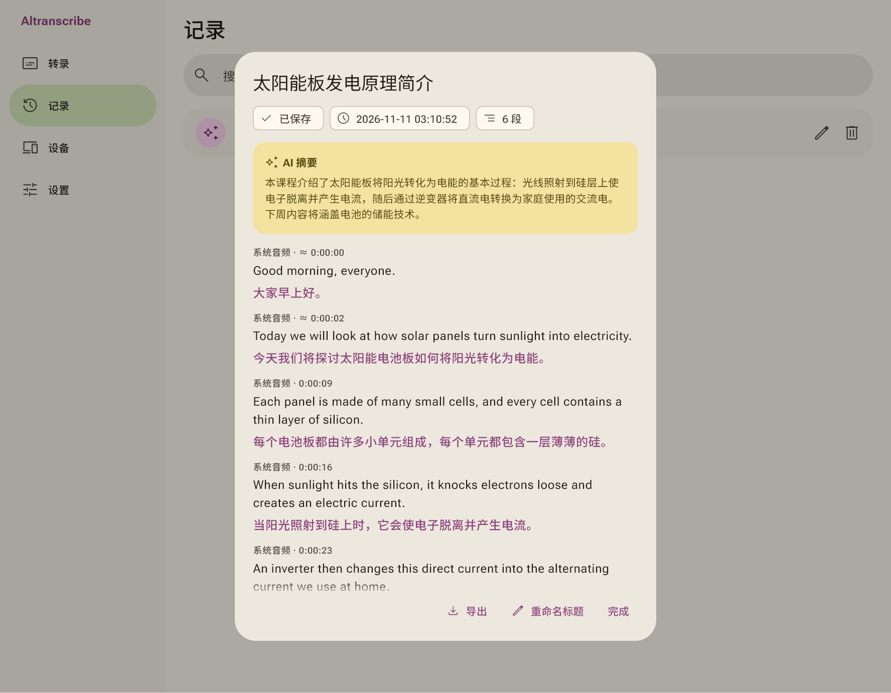

<p align="center"><picture><source media="(prefers-color-scheme: dark)" srcset="docs/images/logo-on-dark.png"></picture></p>

# Altranscribe

Windows、Android 和 macOS 上的实时转录与翻译应用：把麦克风、系统声音或音视频文件变成文稿，并显示双语悬浮字幕。

Windows 和 Android 共用一个 Flutter 应用；Mac 上是单独的原生应用，用 SwiftUI 为 macOS 26 和 Apple 芯片编写，位于 [`apple/`](apple/README.md)，见下文 [macOS](#macos) 一节。

[English](README.md)



<details><summary>深色主题</summary>



</details>

## 下载使用

1. 从 [Releases](https://github.com/kiliasu/Altranscribe/releases) 下载 Windows zip 或 Android APK。
2. **Windows x64**：解压后运行 `Altranscribe.exe`。请保持文件夹完整，程序依赖同目录下的 DLL 和 `data/`。如果提示缺少 DLL，请安装 [Visual C++ x64 运行库](https://aka.ms/vs/17/release/vc_redist.x64.exe)。文件转录还需要安装 [FFmpeg](https://ffmpeg.org/download.html) 并加入 PATH。
3. **Android 10 及以上（ARM64）**：安装 APK，按提示允许安装来自该来源的应用。音频解码组件已包含在包内。首次使用相应功能时，应用会申请麦克风、相机（扫描主机的配对码）、通知（转录期间后台服务会显示一条通知）和「显示在其他应用上层」（悬浮字幕）权限；系统音频采集每次都需要确认。音视频文件也可以从系统分享菜单发送给应用。
4. **macOS 26 及以上（Apple 芯片）**：暂无签名的下载包，请按 [macOS](#macos) 一节自行构建，再把 `Altranscribe.app` 拖进「应用程序」。

程序没有代码签名，首次运行时 Windows 可能提示"已保护你的电脑"，点"更多信息 → 仍要运行"即可。

## 开始使用

1. 在「设置 → 模型选择」中选择识别方式：本机 Whisper、本机 CPU 上的 Nemotron 流式模型（手机也能用）、RTX 5090 这类 32 GB Blackwell 显卡上的 Nemotron 3.5 Transcribe、局域网里的 Windows 主机，或 OpenAI / Gemini。
2. 如需翻译、标题和摘要，在「设置 → 翻译选择」配置文字模型；暂不需要时可以在首页关闭。开始前可以在首页点「准备 LLM」，先加载好模型，开头的译文就不会落后。
3. 选择麦克风、系统音频或两者，设置源语言和目标语言后开始。转录音视频文件时切换到文件入口，可以一次选择多个，按队列处理。
4. 点击「停止并保存」后，文稿进入「记录」。尾句、译文和摘要会在后台补齐，完成后才能开始下一次任务。

暂停会停止采集新音频，已收到的片段继续处理；「直接遗弃」会删除当前文稿。关闭悬浮字幕只隐藏窗口，不会停止转录。

**键盘（Windows）**：`Ctrl+1` 到 `Ctrl+4` 切换转录、记录、设备和设置，`Ctrl+F` 搜索记录，`Ctrl+O` 添加文件；`Ctrl+Shift+R` 开始，`Ctrl+Shift+P` 暂停或继续，`Ctrl+Shift+S` 停止并保存，`Ctrl+Shift+C` 开关悬浮字幕；`Ctrl` 加 `+`、`-`、`0` 调整文稿字号。

**Windows 本地模型**：从 [whisper.cpp](https://github.com/ggml-org/whisper.cpp) 获取 `whisper-server.exe`，在模型设置中填写路径并选择 CPU 或 GPU。点击模型旁的下载按钮即可下载 Tiny 到 Large v3 Turbo 并自动校验；手动放入模型的方法见 [模型说明](docs/zh-CN/models.md)。Nemotron 3.5 Transcribe 需要 NVIDIA 的 [NeMo-Speech.cpp](https://github.com/NVIDIA/NeMo-Speech.cpp)，模型在同一面板下载，见[相关说明](docs/zh-CN/models.md#nemotron-35-transcribe)。翻译和摘要可以用本机运行的 Ollama 或其他 OpenAI 兼容文字服务，也可以填写在线 OpenAI 兼容服务的地址和 API Key，或直接使用 OpenAI、Gemini、Anthropic。

其他用法见 [云端服务](docs/zh-CN/cloud-providers.md) 和 [连接 Windows 主机](docs/zh-CN/remote-processing.md)，后者能让手机使用电脑上的模型：在电脑上开启共享，用手机扫描它显示的二维码，主机就会出现在手机的「设备」页。手机也可以用 Nemotron 自己转录，只把翻译和摘要交给电脑。

## 功能

| 处理方式 | Windows x64 | Android 10+ ARM64 | macOS 26+（Apple 芯片） |
| --- | --- | --- | --- |
| 本地 Whisper | CPU / NVIDIA GPU | 不支持 | Metal |
| 本地 Nemotron 流式（CPU，sherpa-onnx） | 支持 | 支持 | 支持 |
| 本地 Nemotron 3.5 Transcribe（32 GB Blackwell 显卡，NeMo-Speech.cpp） | 支持 | 不支持 | 不支持 |
| 本地 Parakeet（FluidAudio，Core ML）与 Apple SpeechTranscriber | 不支持 | 不支持 | 支持 |
| 本地 Ollama / OpenAI 兼容文字服务 | 支持 | 通过 Windows 主机使用 | 支持 |
| 设备端 Apple Intelligence 文字模型 | 不支持 | 不支持 | 支持 |
| 局域网共享 | 可作为主机或客户端 | 作为客户端 | 不支持 |
| OpenAI / Gemini（语音与文字）、Anthropic 与在线 OpenAI 兼容服务（文字） | 支持 | 支持 | 支持 |

- 麦克风与系统音频可以分别或同时转录，并实时翻译。
- 悬浮字幕可以显示原文、译文或双语，字体、字号、透明度和显示的句数都可调；在字幕窗口里就能暂停、继续或停止保存。
- 批量处理 WAV、MP3、M4A、FLAC、OGG、Opus、AAC、WMA、MP4、MKV、WebM、MOV 文件，生成文稿、译文、标题和摘要；能否读取取决于文件的实际编码。
- 文稿支持搜索、复制、重命名和删除，可导出为 TXT、Markdown、SRT 字幕或网页，也能跳转到原文件。附带音视频的网页会高亮正在播放的句子，并可跟随播放滚动。
- 人名译法保持一致：实时翻译会沿用前文对同一名字的译法，翻译文件时每个名字只用一个固定译名。可在「设置 → 翻译选择」里填写自己的翻译要求，例如语气或指定译名。
- 文件处理还可以修正人名、术语和听错的词，并可单独开启合并被切断的句子；原文和每处修改都能查看。
- 简体中文 / English 界面，明暗主题，琥珀或基线配色。





识别和翻译可能出错，带「≈」的时间码是估算值。目前没有讲者区分、WebVTT 导出和应用内回听。应用会按上次关闭时的样子打开：界面语言（首次运行跟随系统）、主题、字号、源语言与目标语言、音频来源和各项选项都会记住，字幕设置也一样。

## macOS

Mac 版是单独的原生应用，版本 1.0.0，用 SwiftUI 和 AppKit 编写，功能思路相同：实时转录与翻译、文件队列、悬浮字幕和可搜索的记录库。界面遵循 macOS 26 的设计：底栏和悬浮字幕使用 Liquid Glass，侧栏按日期列出全部文稿，设置在独立窗口中打开。

- **语音**：Nemotron 流式英语版或 3.5 多语言版（sherpa-onnx，CPU，默认）、Metal 上的 Whisper Tiny 到 Large v3、通过 FluidAudio 在 Core ML 上运行的 Parakeet v2、v3 和 Ultra（英语，或 25 种欧洲语言）、Apple SpeechTranscriber，或 OpenAI / Gemini 的文件转录、实时转录和语音直译。模型在设置中下载（Nemotron 和 Whisper 以 SHA-256 校验），应用本身不带模型。
- **文字**：设备端 Apple Intelligence、Ollama 等 OpenAI 兼容服务、OpenAI、Gemini 或 Anthropic，用于翻译和摘要。
- **采集**：指定的麦克风或系统声音（一次一个），自适应增益能提升较轻或较远的声音。实时会话默认保存一份 M4A 录音，可关闭「保存录音」。
- **文件**：可拖入音频、视频或整个文件夹；macOS 能解码 WAV、M4A、MP3、AAC、AIFF、MP4 和 MOV，「低音量增强」适合远距离录音。
- **记录**：搜索的词会在文稿中标出；文稿可导出为 TXT、Markdown、HTML 或 SRT，删除时连同录音移到废纸篓。

Mac 版不包含局域网共享、主机配对、FFmpeg、自动术语纠错和网页播放器，一次只采集一个音源。各引擎、数据与模型目录、权限和验证记录见 [macOS 说明](apple/README.md)。

## 隐私

Windows 和 Android 上，实时音频只在内存中处理，不保存录音；macOS 版默认把每次实时会话的 M4A 录音保存在 `~/Documents/Altranscribe/Recordings/`，可关闭「保存录音」。文稿保存在发起任务的设备上：Windows 在 `%LOCALAPPDATA%\Altranscribe\`，Android 在应用私有目录，Mac 在 `~/Library/Application Support/Altranscribe/`。删除文稿不会删除导入的音视频文件。诊断日志不含文稿和 Key，Windows 上写在 `文档\Altranscribe\logs`，Android 上写在应用可分享的目录；「设置 → 日志」可以打开或分享。

使用云端服务时，音频和相关文字会发送给对应的提供商；交给主机处理的内容会发送给该主机。全本地处理不上传任何内容。API Key 和主机凭据由操作系统加密保存（Mac 上是钥匙串），换电脑或手机后需要重新填写。局域网共享使用未加密的 HTTP（Android 版因此允许明文流量），只应在可信网络中使用。云端服务始终使用 HTTPS，并可能产生费用。

## 从源码构建

需要 Windows、Flutter 3.47.3，以及安装了「使用 C++ 的桌面开发」的 Visual Studio 2022（或 Build Tools 2022）。

```powershell
./dev.ps1 -Verify
./dev.ps1
```

第一条运行静态分析和全部测试，第二条启动应用。`./dev.ps1 -Build -Release` 构建正式版，输出在 `build/windows/x64/runner/Release/`。Android 构建、代码结构和分发要求见 [开发说明（英文）](docs/CONTRIBUTING.md)。

macOS 版需要 Apple 芯片的 Mac、macOS 26、Xcode 27 或更新版本，以及 CMake（`brew install cmake`）。在仓库根目录运行：

```sh
bash apple/scripts/bootstrap-whisper.sh
bash apple/scripts/build-app.sh
open build/macos/Altranscribe.app
```

第一条脚本用 Metal 构建固定版本的 whisper.cpp，第二条构建 Swift 包并组装一个本地临时签名的应用。macOS 会申请麦克风权限，采集系统声音还需要「屏幕与系统音频录制」权限。重新构建会改变签名，此时请在「隐私与安全性」中移除旧的 Altranscribe 条目，再添加新的应用。`swift test --package-path apple` 运行它的测试。

## 许可证

应用代码采用 [MIT](LICENSE) 许可证。第三方组件遵循各自的许可证，见 [第三方组件与许可](docs/zh-CN/third-party.md)；Android 版包含 LGPL 2.1+ 的 FFmpeg。
