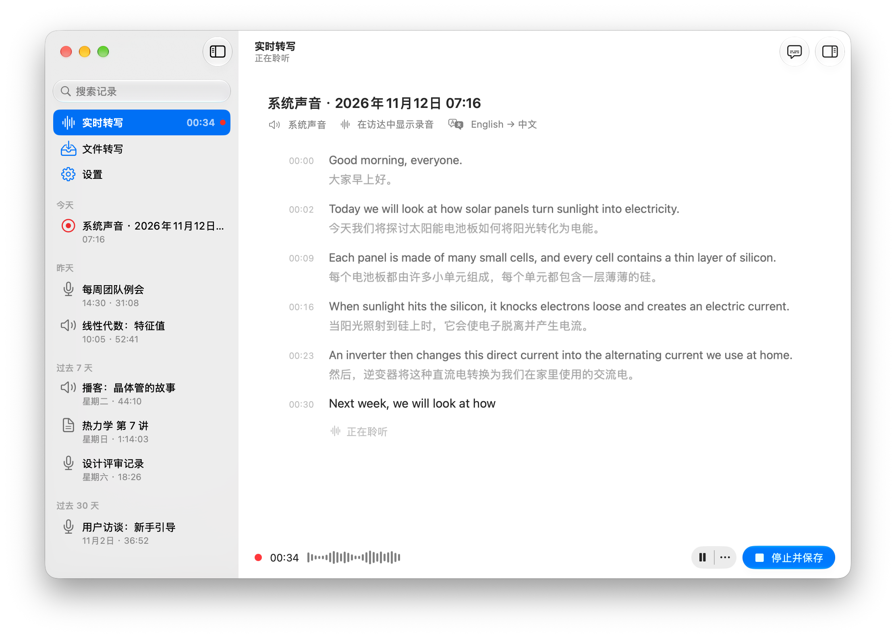
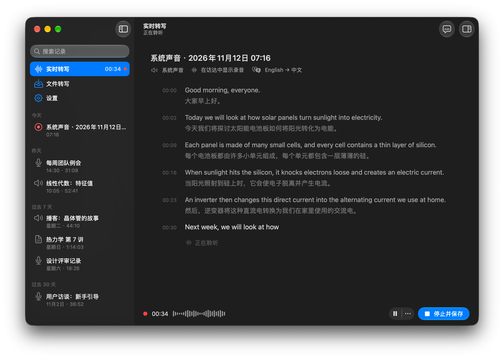
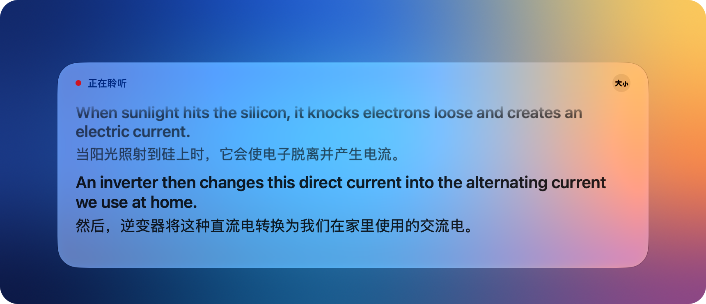
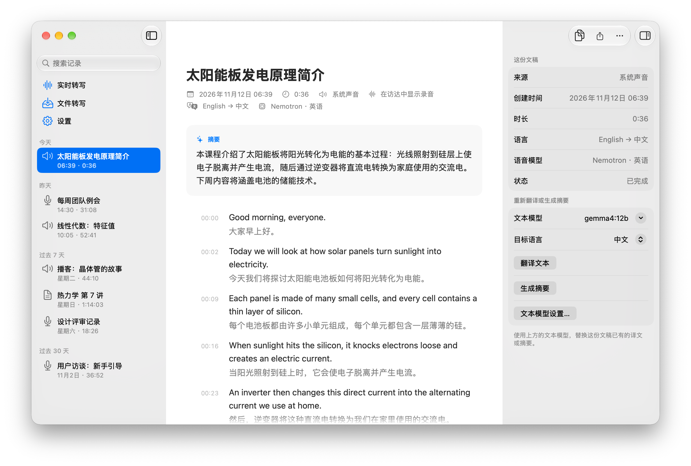

<p align="center"><picture><source media="(prefers-color-scheme: dark)" srcset="docs/images/logo-on-dark.png"></picture></p>

# Altranscribe

Windows、Android 和 macOS 上的实时转录与翻译应用：把麦克风、系统声音或音视频文件变成文稿，并显示双语悬浮字幕。

[English](README.md)


<details><summary>深色主题</summary>


</details>

## 下载使用

从 [Releases](https://github.com/kiliasu/Altranscribe/releases) 下载：

- **Windows x64**：解压 zip，运行 `Altranscribe.exe`，文件夹需保持完整。程序没有代码签名，首次运行时 Windows 可能提示"已保护你的电脑"，点"更多信息 → 仍要运行"。提示缺少 DLL 时，安装 [Visual C++ x64 运行库](https://aka.ms/vs/17/release/vc_redist.x64.exe)；转录音视频文件还需要把 [FFmpeg](https://ffmpeg.org/download.html) 加入 PATH。
- **Android 10 及以上（ARM64）**：安装 APK，按提示允许安装来自该来源的应用。麦克风、相机、通知和悬浮窗权限在用到时才申请。
- **macOS 26 及以上（Apple 芯片）**：打开 DMG，把 Altranscribe 拖进「应用程序」。应用未经 Apple 公证，首次打开被拦下后，到「系统设置 → 隐私与安全性」点「仍要打开」。

## 开始使用

1. 在「设置 → 模型选择」选择识别方式：本地模型、局域网里的 Windows 主机，或 OpenAI / Gemini。本地模型在同一面板下载，Windows 上运行它们的程序也在其中。
2. 需要翻译、标题和摘要时，在「设置 → 翻译选择」选择文字模型：本机或在线的 OpenAI 兼容服务（如 Ollama），或 OpenAI、Gemini、Anthropic。
3. 选择麦克风、系统音频或两者，设置源语言和目标语言后开始。转录音视频文件时切换到「文件」，可以一次添加多个。
4. 点「停止并保存」后，文稿进入「记录」，尾句、译文和摘要在后台补齐。

手机可以使用电脑上的模型：在电脑的「设备」页开启共享，用手机扫描二维码配对，见[连接 Windows 主机](docs/zh-CN/remote-processing.md)。各模型的要求见[模型说明](docs/zh-CN/models.md)，云端服务的配置见[云端服务](docs/zh-CN/cloud-providers.md)。

## 功能

| 处理方式 | Windows x64 | Android 10+ ARM64 | macOS 26+（Apple 芯片） |
| --- | --- | --- | --- |
| 本地 Whisper | CPU / NVIDIA GPU | 不支持 | 支持 |
| 本地 Nemotron 流式模型（CPU） | 支持 | 支持 | 支持 |
| 本地 Nemotron 3.5 Transcribe | RTX 5090 等 32 GB 显卡 | 不支持 | 不支持 |
| 本地 Parakeet、Apple SpeechTranscriber | 不支持 | 不支持 | 支持 |
| 本地 Ollama 等 OpenAI 兼容文字服务 | 支持 | 通过 Windows 主机使用 | 支持 |
| 设备端 Apple Intelligence 文字模型 | 不支持 | 不支持 | 支持 |
| 局域网共享 | 主机或客户端 | 客户端 | 不支持 |
| OpenAI / Gemini（语音与文字），Anthropic 与在线 OpenAI 兼容服务（文字） | 支持 | 支持 | 支持 |

- 麦克风与系统音频可以分别或同时转录，并实时翻译。
- 悬浮字幕可以显示原文、译文或双语，字体、字号、透明度和句数可调。
- 批量处理 WAV、MP3、M4A、FLAC、OGG、Opus、AAC、WMA、MP4、MKV、WebM、MOV 文件，生成文稿、译文、标题和摘要。
- 文稿可以搜索、复制、重命名和删除，导出为 TXT、Markdown、SRT 字幕或网页，也能跳转到原文件。附带音视频的网页会高亮正在播放的句子，并跟随播放滚动。
- 人名译法前后一致；可以在「设置 → 翻译选择」里写下自己的翻译要求，例如语气或指定译名。
- 文件处理可以修正人名、术语和听错的词，并合并被切断的句子；原文和每处修改都能查看。
- 简体中文 / English 界面，明暗主题，琥珀或基线配色。


识别和翻译可能出错，带「≈」的时间码是估算值；文件能否读取取决于它的实际编码。目前没有讲者区分、WebVTT 导出和应用内回听。

## macOS

Mac 版是单独的原生应用，同样提供实时转录与翻译、文件队列、悬浮字幕和可搜索的记录库。



<details><summary>深色外观</summary>



</details>

与 Windows 版的不同之处：

- 语音识别可选 Nemotron 流式模型（默认）、Whisper、Parakeet（英语及 25 种欧洲语言）、系统的 Apple SpeechTranscriber，或 OpenAI / Gemini；模型在设置中下载。
- 翻译和摘要还可以使用设备端的 Apple Intelligence。
- 一次采集一个音源：麦克风或系统声音。
- 文件支持 WAV、M4A、MP3、AAC、AIFF、MP4 和 MOV，可以拖入整个文件夹。
- 没有局域网共享、自动术语纠错和网页播放器。





各引擎、数据目录和权限见 [macOS 说明](apple/README.md)。

## 隐私

- **音频**：Windows 和 Android 上，实时音频只在内存中处理，不保存录音。Mac 版默认把每次实时会话的录音保存在 `~/Documents/Altranscribe/Recordings/`，可以关闭「保存录音」。
- **文稿**：保存在发起任务的设备上。Windows 在 `%LOCALAPPDATA%\Altranscribe\`，Android 在应用私有目录，Mac 在 `~/Library/Application Support/Altranscribe/`。删除文稿不会删除导入的音视频文件。
- **上传**：全本地处理不上传任何内容。使用云端服务时，音频和相关文字会发送给对应的提供商，并可能产生费用；交给主机处理的内容会发送给该主机。
- **凭据**：API Key 和主机凭据由操作系统加密保存，换设备后需要重新填写。
- **局域网共享**：使用未加密的 HTTP，只应在可信网络中使用。云端服务始终使用 HTTPS。
- **日志**：不含文稿和 Key，可在「设置 → 日志」中打开或分享。

## 从源码构建

**Windows**：需要 Flutter 3.47.3，以及安装了「使用 C++ 的桌面开发」的 Visual Studio 2022（或 Build Tools 2022）。

```powershell
./dev.ps1
./dev.ps1 -Build -Release
```

第一条启动应用，第二条构建正式版，输出在 `build/windows/x64/runner/Release/`。Android 构建、测试和代码结构见 [开发说明（英文）](docs/CONTRIBUTING.md)。

**macOS**：需要 Apple 芯片的 Mac、macOS 26、Xcode 27 或更新版本，以及 CMake（`brew install cmake`）。在仓库根目录运行：

```sh
bash apple/scripts/bootstrap-whisper.sh
bash apple/scripts/build-app.sh
open build/macos/Altranscribe.app
```

把构建出的 `Altranscribe.app` 拖进「应用程序」即可。采集系统声音需要「屏幕与系统音频录制」权限，其余见 [macOS 说明](apple/README.md)。

## 许可证

应用代码采用 [MIT](LICENSE) 许可证。第三方组件遵循各自的许可证，见 [第三方组件与许可](docs/zh-CN/third-party.md)；Android 版包含 LGPL 2.1+ 的 FFmpeg。
